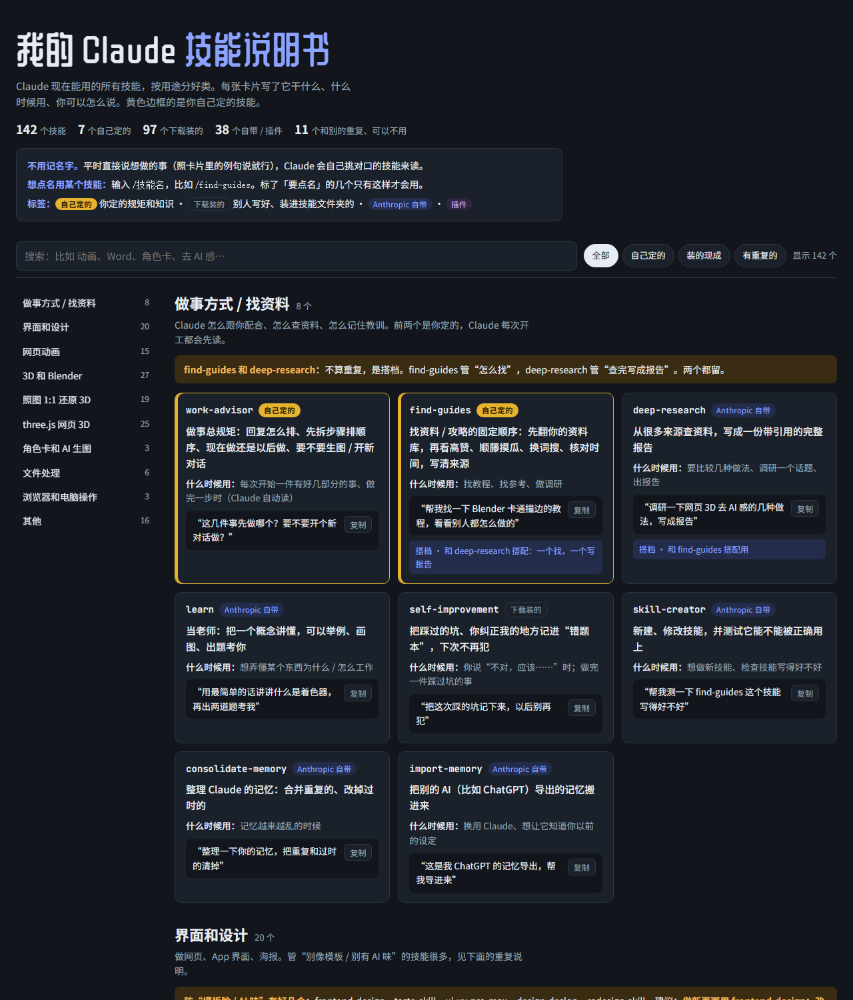

# Clawork

**Which AI skill goes with which project, drawn as a 3D base.** Every project I run with Claude Code is a pixel "Clawd" standing in a factory yard; the skills (reusable instruction files) it carries are the gear on its back. The page is generated from one JSON file that lists all my skills by category, plus a log of which conversation actually read which skill, so I can see at a glance what each project depends on and which skills are never used.

One of three dashboards in my AI workflow: [Clawnveyor](https://github.com/Miaomiaomeowmeow/clawnveyor) (the inspiration pipeline as a warehouse) → **Clawork** (skills × projects) → [Clawdfield](https://github.com/Miaomiaomeowmeow/clawdfield) (project status workbench).

**Live:** https://miaomiaomeowmeow.github.io/clawork/ (snapshot of my own setup, Chinese / English toggle on the page)

`index.html` is a single self-contained page (three.js from CDN). Designed and art-directed by Miaomiao; built by directing Claude Code. 2026. CC BY-NC-SA 4.0.
